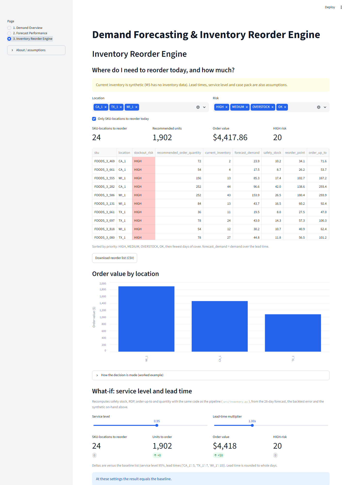
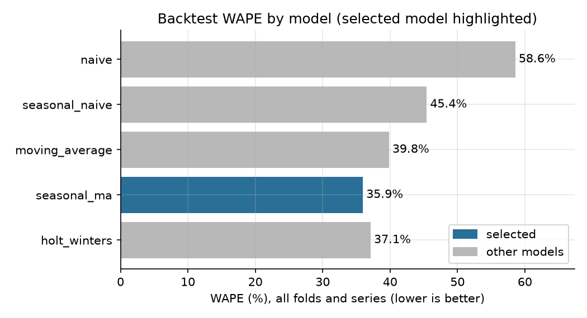
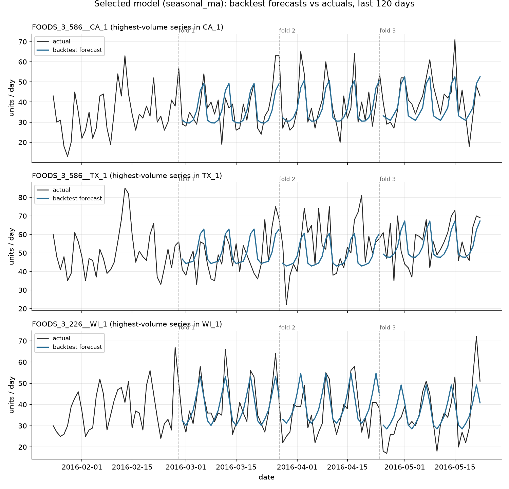
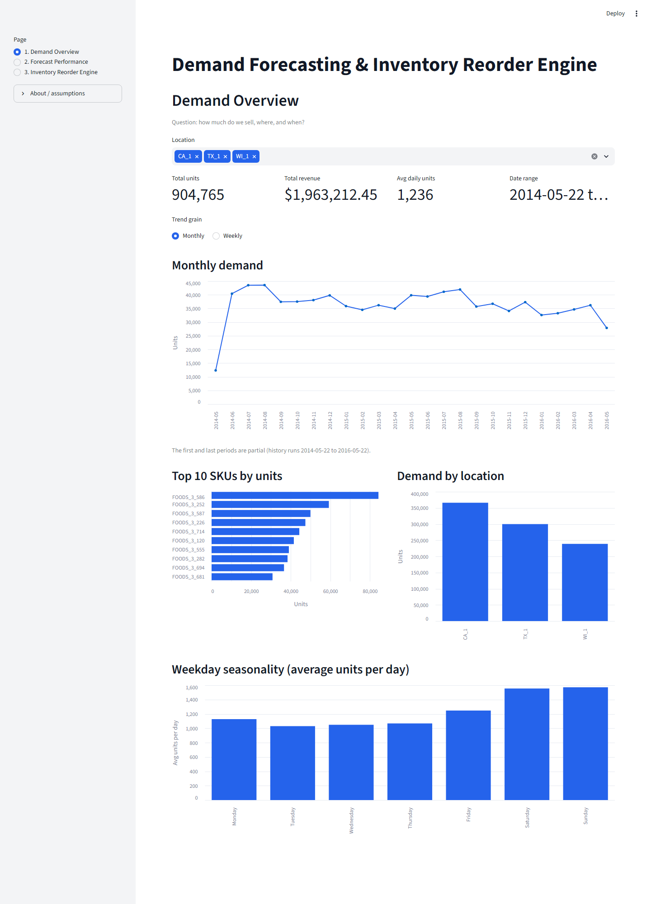
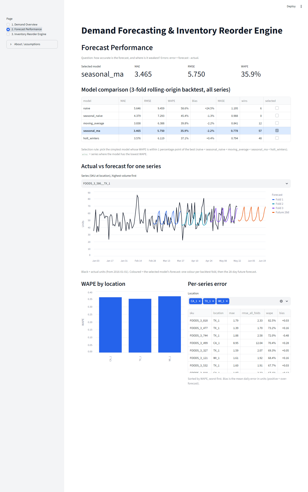

# Demand Forecasting & Inventory Reorder Engine

> **Which SKU/location should we reorder today, and how much?**

**Live demo:** _LIVE_URL_ · **Stack:** Python (pandas, NumPy, statsmodels, Matplotlib) · SQL (SQLite / PostgreSQL) · Power BI · Streamlit



---

## 1. Project overview
This project turns two years of daily Walmart sales into a **daily reorder list**. For each SKU × store it gives a recommended
order quantity and a stockout-risk flag. The forecast is an input to that decision, not the deliverable.

```
Historical sales → cleaning → daily time series → 5 baseline forecasts → rolling-origin backtest → model selection
→ 28-day demand forecast + forecast error (σ)
──────────────────────── FORECASTING │ INVENTORY DECISION ────────────────────────
→ safety stock → reorder point → order-up-to level → order quantity (case packs) → risk flag
→ daily reorder list → policy replay → SQL layer → Power BI / Streamlit dashboard
```

## 2. Business problem
Inventory decisions have two failure modes:
- **Over-ordering** ties up working capital and shelf space.
- **Under-ordering** causes stockouts and lost sales.

The engine sets a buffer (safety stock) based on how wrong the forecast has actually been. It then reorders only when the inventory
position drops to the reorder point.

## 3. Dataset
**M5 Forecasting (Walmart)**, taken from the public [Nixtla mirror](https://github.com/Nixtla/m5-forecasts) of the M5 competition data.
This mirror needs no Kaggle login. Full profile: [`reports/data_profile.md`](reports/data_profile.md). Every number in that profile is generated by code.

| | |
|---|---|
| Scope | Department `FOODS_3`, stores `CA_1`, `TX_1`, `WI_1` (one store per state) |
| Selection funnel | 823 FOODS_3 items → 46 pass the zero-sales rule → **41 pass the launch rule** |
| Series | **123 SKU × store series** (41 items × 3 stores) |
| History | 2014-05-22 → 2016-05-22 (732 days) |
| Clean rows | **90,036** (0 duplicates, 0 negative sales) |
| Disk | The pipeline keeps a ~25 MB unmodified raw extract, not the full ~520 MB download |

**Sampling rules.** They are applied only to data up to the first backtest origin, so the selection doesn't look ahead.
- An item qualifies only if it has ≤ 20% zero-sales days in **every** store over the year before 2016-02-28.
- It must also have sold within the first 28 days of the window. This excludes items that weren't launched yet.
- These two rules keep continuously stocked fast movers. Intermittent items need different methods, such as Croston, and are out of scope.

**Cleaning:**
- Dec-25 store closures are imputed from the same weekday a week earlier (246 rows).
- Zero-sales runs of 7+ days are **flagged** as likely stockouts but not imputed (2,125 days). Sales ≠ demand; see limitations.
- Outliers (> Q3 + 3·IQR within each series) are flagged and kept, because they are real demand spikes (218 days).

## 4. Forecasting methodology
There are five models, from simplest to most complex. Each is a pure function `f(train, horizon) → forecast` in [`src/models.py`](src/models.py).

| Model | Logic |
|---|---|
| `naive` | Last observed value |
| `seasonal_naive` | Same weekday last week |
| `moving_average` | Mean of the last 28 days |
| `seasonal_ma` | 28-day level × day-of-week index from the last 364 days (classical decomposition baseline) |
| `holt_winters` | statsmodels ExponentialSmoothing: damped additive trend, additive weekly seasonality |

**Validation:** a rolling-origin backtest. Three expanding-window folds each forecast 28 days, covering the last 84 days of
history (origins 2016-02-28, 03-27, 04-24). There is **no random splitting**, and a unit test asserts that the training data never
passes its fold's origin.

**Metrics:**
- MAE, RMSE, **WAPE** (Σ|error| / Σactual, the headline percentage metric), Bias and MASE.
- MAPE is not the headline metric because daily SKU sales include zeros, which make it undefined. A MAPE on non-zero days only is reported as a secondary column.

**Selection rule (parsimony):** use the **simplest** model whose overall WAPE is within 1 percentage point of the best. A more
complex model has to earn its place.

## 5. Model comparison
Results pool 123 series × 3 folds × 28 days (10,332 forecasts per model), from [`outputs/model_comparison.csv`](outputs/model_comparison.csv).

| Model | MAE | RMSE | WAPE | Bias | MASE | Series won |
|---|---|---|---|---|---|---|
| naive | 5.646 | 9.459 | 58.6% | +24.5% | 1.195 | 6 |
| seasonal_naive | 4.379 | 7.293 | 45.4% | −1.3% | 0.988 | 0 |
| moving_average | 3.838 | 6.388 | 39.8% | −2.2% | 0.841 | 12 |
| **seasonal_ma ✅** | **3.465** | **5.750** | **35.9%** | −2.2% | **0.778** | **57** |
| holt_winters | 3.576 | 6.119 | 37.1% | +0.4% | 0.794 | 48 |

**Selected: `seasonal_ma`.** It has the lowest WAPE overall and in every fold:

| Fold | `seasonal_ma` WAPE | `holt_winters` WAPE |
|---|---|---|
| 1 | 38.2% | 38.6% |
| 2 | 37.0% | 39.5% |
| 3 | 32.9% | 33.4% |

No simpler model comes within 1 pp of it. Holt-Winters adds parameters and does not beat a weekday-adjusted moving average on these
series. A WAPE of about 36% is typical for daily SKU-store units, which are small, noisy counts. MASE < 1 means the selected model
beats a seasonal-naive forecast.




## 6. Inventory methodology
The inventory decision lives in [`src/inventory.py`](src/inventory.py), which **never fits a model**. It reads only the 28-day forecast and the backtest error statistics.
A plain-English walkthrough is in [`docs/how_a_forecast_becomes_an_order.md`](docs/how_a_forecast_becomes_an_order.md).

| Assumption | Value | Source |
|---|---|---|
| Service level | 95% cycle service level → Z = 1.645 (`scipy.stats.norm.ppf`) | **Assumed** |
| Lead time | CA_1 = 5 days, TX_1 = 7, WI_1 = 10 | **Assumed** (illustrative) |
| Demand variability σ | Each series' RMSE of daily forecast errors across the 3 backtest folds | **From the model** |
| Review / order cycle | Reviewed daily; each order covers lead time + 7 days | **Assumed** |
| Case pack | 6 units; orders round up to whole cases | **Assumed** (M5 has no pack sizes) |
| Current inventory | `round(U(0, 45) days × mean daily forecast)`, seed 42 | **SYNTHETIC**: M5 has no inventory data |
| Open orders | 0, so inventory position = on-hand | **Assumed** |
| Price | Latest observed `sell_price` | From the data |

## 7. Safety stock
```
Safety Stock = Z × σ × √L
```
σ is the **forecast error**, not raw demand variability. Safety stock only needs to cover what the forecast can't predict. RMSE is
used instead of standard deviation so that any forecast bias is covered too.

## 8. Reorder point
```
Lead-time demand  = Σ forecast over the next L days
Reorder point     = lead-time demand + safety stock
Order-up-to (S)   = reorder point + Σ forecast for the 7 days after the lead time
If inventory position ≤ reorder point → order ceil((S − IP) / case pack) × case pack, else 0 (never negative)
```

**Risk flags**, in priority order:

| Flag | Rule | Meaning |
|---|---|---|
| `HIGH` | on-hand < lead-time demand | Stock runs out before an order placed today can arrive |
| `MEDIUM` | on-hand ≤ reorder point | Reorder now to stay protected |
| `OVERSTOCK` | days of cover > 30 | Working capital is tied up |
| `OK` | otherwise | No action needed |

## 9. Example reorder decision
This is a real row from [`reports/reorder_examples.md`](reports/reorder_examples.md), run date 2016-05-23: **FOODS_3_746 at CA_1**.

| Step | Calculation |
|---|---|
| Lead-time demand | Forecast for the next 5 days = **24.5** units |
| Safety stock | 1.645 × 3.14 × √5 = **11.5** |
| Reorder point | 24.5 + 11.5 = **36.0** |
| Order-up-to | 36.0 + 37.5 (7-day cycle demand) = **73.5** |
| Inventory position | **23** (synthetic) ≤ 36.0 → reorder |
| Quantity | ceil((73.5 − 23) / 6) × 6 = **54 units (≈ $106.92)** |
| Risk | **HIGH**: 23 on hand < 24.5 expected before the delivery arrives |

**Today's list** ([`outputs/reorder_list_today.csv`](outputs/reorder_list_today.csv)):
- **24 of 123** SKU-locations need an order today: **1,902 units, $4,417.86**.
- **20** are HIGH risk.
- By store: CA_1 has 5 orders / $1,458.12, TX_1 has 8 / $1,077.00, and WI_1 has 11 / $1,882.74.

## 10. Dashboard screenshots
These come from the live Streamlit app, which has the same three pages as the Power BI design.
To build the `.pbix`, follow [`dashboard/POWERBI_GUIDE.md`](dashboard/POWERBI_GUIDE.md); measures are in [`dashboard/measures.dax`](dashboard/measures.dax).

| Page 1: Demand Overview | Page 2: Forecast Performance |
|---|---|
|  |  |

Page 3, the Inventory Reorder Engine, is shown at the top of this README. It also has a **what-if** panel with service-level and
lead-time sliders. The panel recomputes the list using the same `src/inventory.py` functions, and a test confirms that the
default settings reproduce `reorder_list.csv` exactly.

The KPIs every dashboard must match are in [`reports/dashboard_reconciliation.md`](reports/dashboard_reconciliation.md).

## 11. Tech stack
| Layer | Tools |
|---|---|
| Data & forecasting | Python 3.12, pandas, NumPy, statsmodels, SciPy |
| Charts | Matplotlib (report figures), Altair (app) |
| SQL | Portable SQL that runs on SQLite (stdlib, used here) and on PostgreSQL/Supabase. See [`sql/README.md`](sql/README.md) |
| Dashboard | Power BI (star-schema CSVs + DAX + build guide), Streamlit (live demo) |
| Quality | pytest (38 tests): models, metrics, leakage, inventory math, SQL reconciliation, app smoke tests |

## 12. Architecture
```
run_pipeline.py
 ├─ src/data_prep.py      download → small raw extract → clean long table (data/processed, git-ignored)
 ├─ src/eda.py            reports/data_profile.md + figures
 ├─ src/backtest.py       rolling-origin backtest of src/models.py → model_comparison.csv, series_error_stats.csv
 ├─ src/forecast.py       refit selected model → forecasts.csv, forecast_next_28d.csv
 ├─ src/plots.py          forecast figures
 ├─ src/inventory.py      SS / ROP / order-up-to / qty / risk → reorder_list.csv, reorder_list_today.csv
 ├─ src/simulate.py       28-day policy replay → policy_simulation.csv
 ├─ src/sql_layer.py      sql/*.sql on SQLite → outputs/sql_results/, reports/sql_reconciliation.md (62 checks)
 └─ src/export_powerbi.py star schema → outputs/powerbi/ + reports/dashboard_reconciliation.md
app.py                    Streamlit app (reads only committed outputs/)
```
The SS / ROP math exists in one place, `src/inventory.py`, and both the pipeline and the app call it. SQL only aggregates the
Python outputs, and every SQL figure reconciles exactly with the Python outputs.

## 13. Results
- **Forecast:** `seasonal_ma`, with WAPE 35.9%, MAE 3.47 units/day, RMSE 5.75 and MASE 0.78.
  - That is a 22.6 pp lower WAPE than the naive forecast (58.6%).
  - It is also 1.1 pp better than Holt-Winters, while being simpler.
- **Decision:** 24 SKU-locations to reorder today, 1,902 units, $4,417.86. 20 of them are HIGH risk.
- **Policy replay.** The last 28 days (fold 3) were replayed day by day, using only information available at the 2016-04-24 origin and actual sales as demand. The engine was compared with a simple rule (28-day average × (L + 7), no safety stock):

| Policy | Fill rate | Stockout series-days | Avg on-hand value / series-day |
|---|---|---|---|
| Naive 28-day MA rule | 91.3% | 371 (10.8%) | $115.62 |
| **This engine** | **96.7%** | **148 (4.3%)** | $150.00 |

The engine cuts stockout days by 60% and raises fill rate by 5.5 pp. The cost is about 30% more average inventory value. That
trade-off is explicit, and the service-level slider in the app shows how it moves.

## 14. Limitations
- **Current inventory is synthetic.** M5 has no stock data, so the *mix* of risk flags reflects the simulated snapshot, not Walmart.
  The method stays the same with real on-hand and open-order data.
- **Sales ≠ demand.** Stockout days record zero sales, which censors demand. Those days are flagged but not imputed, so
  forecasts may understate true demand for affected series.
- **Lead times, service level and case pack are assumptions,** not data.
- **The safety stock formula assumes independent daily errors and a fixed lead time.** Correlated multi-day errors or variable lead times would need a larger buffer.
- **One global model for all series.** `holt_winters` wins on 48 series; per-series selection was deliberately avoided to keep the model simple and avoid overfitting.
- **The policy replay covers only 28 days** of one historical window.
- **Scope is fast movers only.** These are 41 FOODS_3 items in 3 stores; slow and intermittent items would need methods such as Croston.

## 15. How to run locally
```bash
python -m venv .venv
.venv\Scripts\pip install -r requirements.txt        # macOS/Linux: .venv/bin/pip
.venv\Scripts\python run_pipeline.py                 # downloads the ~48 MB M5 zip once, keeps a ~25 MB extract (~1 min)
.venv\Scripts\python -m pytest -q                    # 38 tests
.venv\Scripts\streamlit run app.py                   # dashboard at http://localhost:8501
```
The committed `outputs/` folder lets the app run without the pipeline. Raw and processed data are git-ignored.

## 16. Live demo
**_LIVE_URL_**, hosted on Streamlit Community Cloud.

---
<sub>Data: M5 Forecasting competition (Walmart), via the Nixtla public mirror. Project for portfolio purposes.</sub>
